# 보고프구 월드 데이터

보고프구 월드는 이 저장소에서 **관리자 명단**과 **사진**을 받아 갑니다.
여기서 고치면 월드를 다시 올리지 않아도 **1~2분 뒤** 월드에 반영됩니다.

| 하고 싶은 것 | 하는 곳 |
|---|---|
| 관리자 넣기·빼기 | [`admins.txt`](admins.txt) 고치기 |
| 사진 넣기·바꾸기 | [`images`](images) 폴더에 **칸 이름**으로 올리기 |
| 사진 빼기 | `images` 폴더에서 그 파일 지우기 |
| 고칠 사람 추가 | 저장소 주인이 **Settings → Collaborators** |
| 지금 월드에 나가는 내용 보기 | https://missinge.github.io/bogo-data/ |

---

## 1. 관리자 닉네임 넣기·빼기

1. 위 파일 목록에서 **admins.txt**를 누릅니다.
2. 오른쪽 위 **연필 모양**(Edit this file)을 누릅니다.
3. 한 줄에 한 명씩 **VRChat 닉네임**을 적습니다. 빼려면 그 줄을 지웁니다.
4. 오른쪽 위 초록색 **Commit changes...** 를 누르고, 창이 뜨면 다시 **Commit changes**를 누릅니다.
5. 1~2분 뒤 월드에 있는 모두에게 그 사람 머리 위로 **관리자** 표시가 뜹니다. 이미 월드에 있는 사람에게도 저절로 반영됩니다.

적는 법
- VRChat에 보이는 이름 그대로 적습니다. 띄어쓰기와 특수문자까지 같아야 합니다.
- 영어 대문자·소문자는 구분하지 않습니다.
- `#`으로 시작하는 줄은 메모라서 무시됩니다.
- 관리자가 VRChat 닉네임을 바꾸면 여기도 새 이름으로 고쳐야 합니다.
- 내 머리 위 표시는 나에게는 안 보이고 다른 사람에게만 보입니다.

## 2. 사진 넣기·바꾸기

1. 위 파일 목록에서 **images** 폴더를 누릅니다.
2. 오른쪽 위 **Add file → Upload files**를 누릅니다.
3. 사진 파일 이름을 아래 [칸 목록](#3-칸-목록)의 **칸 이름**으로 바꾼 뒤 끌어다 놓습니다. 예: `hall-1.jpg`
4. 아래 초록색 **Commit changes**를 누릅니다.
5. 1~2분 뒤 월드에 반영됩니다.
   - 새로 들어오는 사람은 들어올 때 받아 갑니다.
   - 이미 월드에 있는 사람도 2분 안에 바뀝니다.
   - VRChat은 사진을 5초에 한 장씩 받아서, 사진이 많으면 가까운 칸부터 차례로 채워집니다.

알아서 맞춰 주는 것
- 사진이 커도 칸에 맞게 줄여서 월드에 보냅니다.
- 칸 모양과 비율이 다르면 **가운데를 기준으로 잘라** 맞춥니다. 중요한 부분은 가운데에 두세요.
- jpg, png, webp, heic(아이폰 사진) 모두 됩니다.

바꾸기·빼기
- 같은 칸 이름으로 다시 올리면 새 사진으로 바뀝니다.
- 확장자가 달라도(예: `hall-1.jpg`가 있는데 `hall-1.png`를 올림) 가장 최근에 올린 파일을 씁니다. 헷갈리지 않게 예전 파일은 지워 주세요.
- 파일을 지우면 그 칸은 빈 액자로 돌아갑니다. 파일을 누르고 오른쪽 위 **…** → **Delete file** → **Commit changes**.

## 3. 칸 목록

알맞은 크기보다 작아도 되지만, 너무 작으면 흐리게 보입니다. 커도 알아서 줄입니다.

### 입장 로비
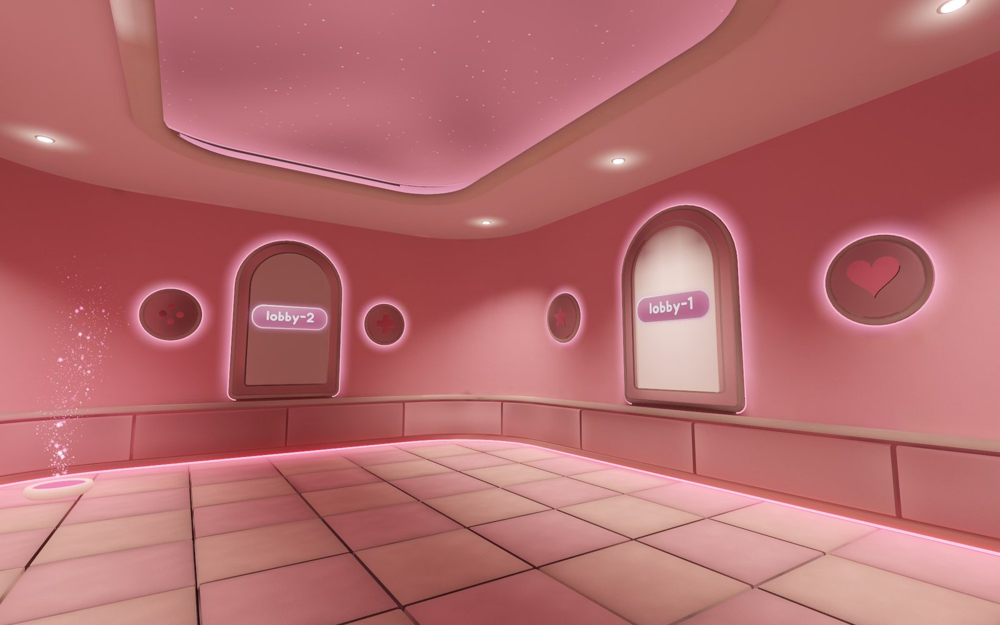

| 칸 이름 | 위치 | 모양 | 알맞은 크기 |
|---|---|---|---|
| `lobby-1` | 입장 로비 정면 | 세로 9:16 | 576×1024 |
| `lobby-2` | 입장 로비 오른쪽 벽 | 세로 9:16 | 576×1024 |

### 1층 홀 아치
들어와서 무대를 볼 때 기준으로 오른쪽·왼쪽입니다.

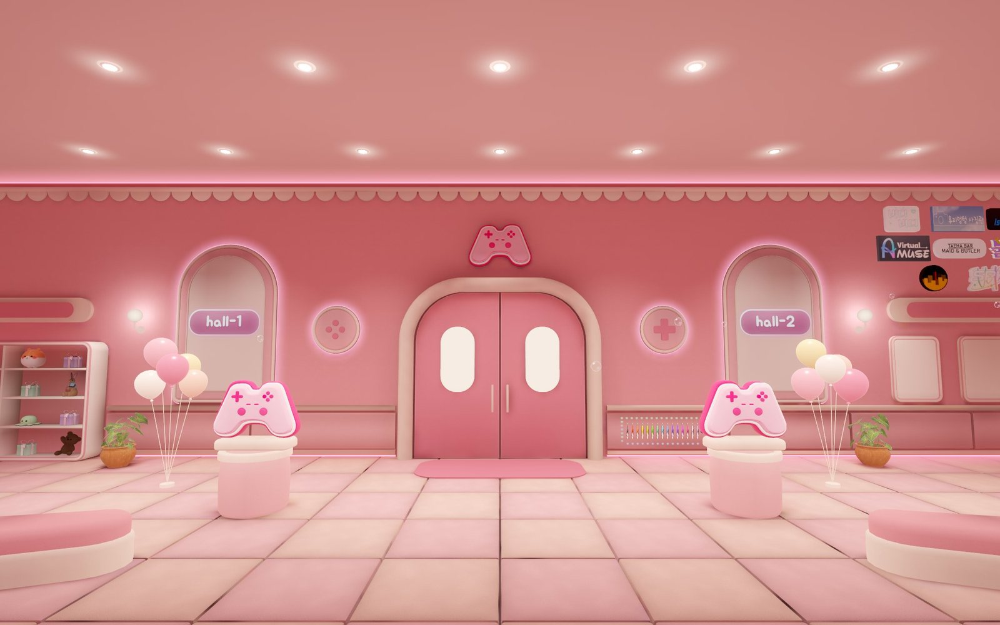
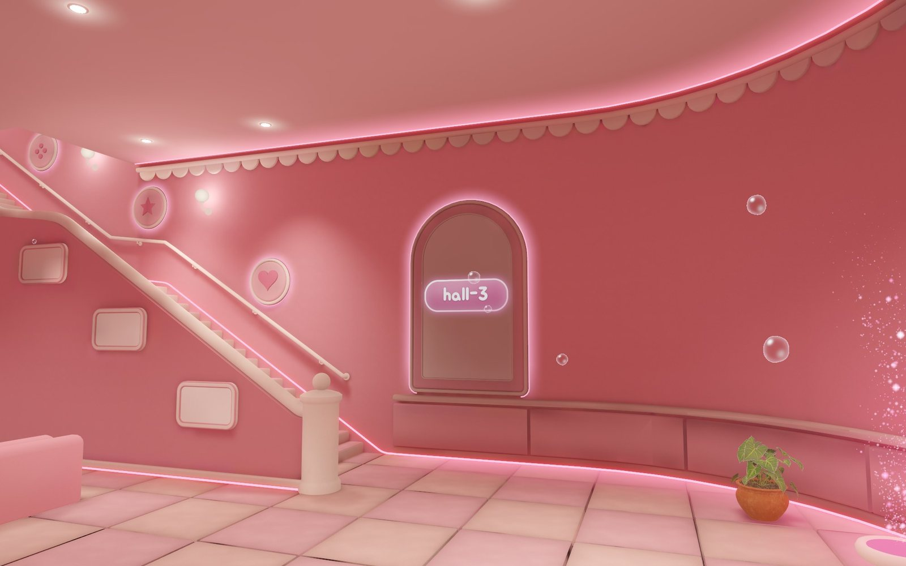
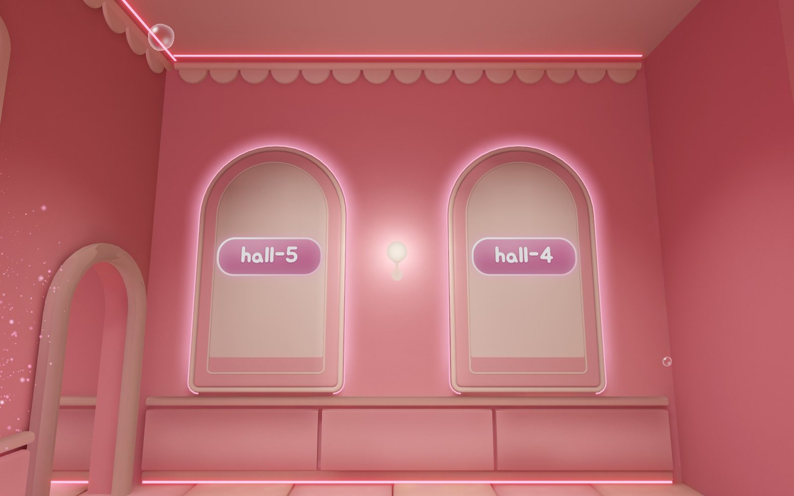
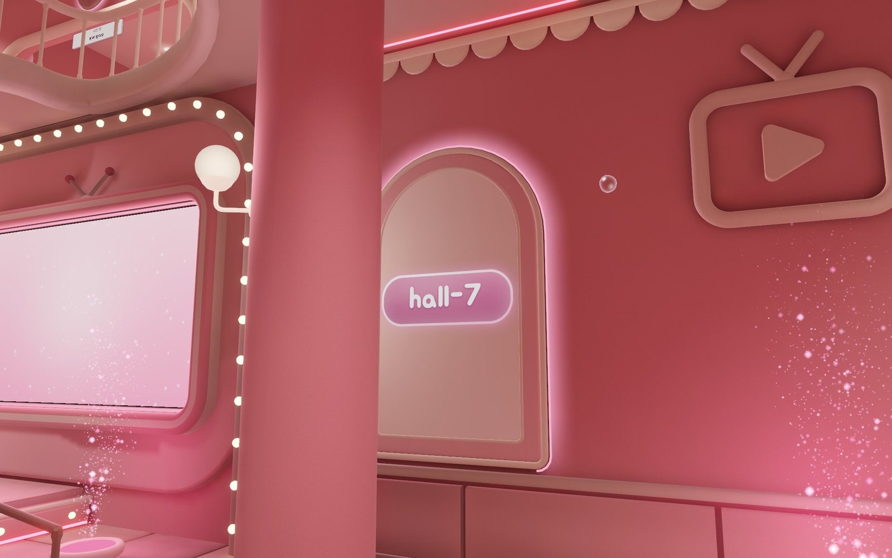
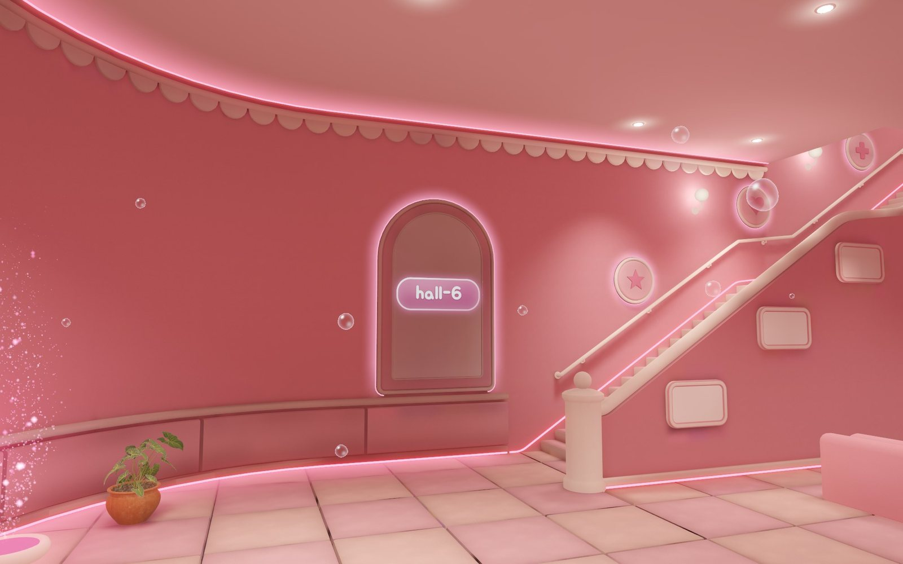

| 칸 이름 | 위치 | 모양 | 알맞은 크기 |
|---|---|---|---|
| `hall-1` | 1층 입구 쪽 벽 | 세로 9:16 | 576×1024 |
| `hall-2` | 1층 입구 쪽 벽 | 세로 9:16 | 576×1024 |
| `hall-3` | 1층 오른쪽 벽 앞 | 세로 9:16 | 576×1024 |
| `hall-4` | 1층 오른쪽 벽 뒤 | 세로 9:16 | 576×1024 |
| `hall-5` | 1층 오른쪽 벽 맨 뒤 | 세로 9:16 | 576×1024 |
| `hall-6` | 1층 왼쪽 벽 앞 | 세로 9:16 | 576×1024 |
| `hall-7` | 1층 비디오방 앞 벽 | 세로 9:16 | 576×1024 |

### 1층 포스터
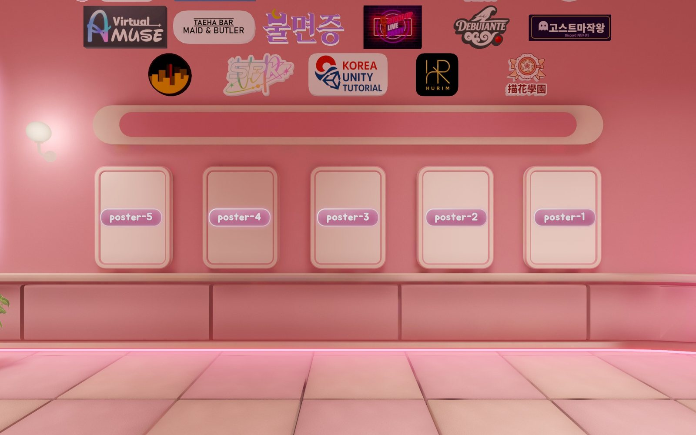

| 칸 이름 | 위치 | 모양 | 알맞은 크기 |
|---|---|---|---|
| `poster-1` | 1층 입구 쪽 벽 포스터 | 세로 A4 | 724×1024 |
| `poster-2` | 1층 입구 쪽 벽 포스터 | 세로 A4 | 724×1024 |
| `poster-3` | 1층 입구 쪽 벽 포스터 | 세로 A4 | 724×1024 |
| `poster-4` | 1층 입구 쪽 벽 포스터 | 세로 A4 | 724×1024 |
| `poster-5` | 1층 입구 쪽 벽 포스터 | 세로 A4 | 724×1024 |

### 1층 계단 사진
번호는 계단 아래쪽부터 1, 2, 3 … 입니다.

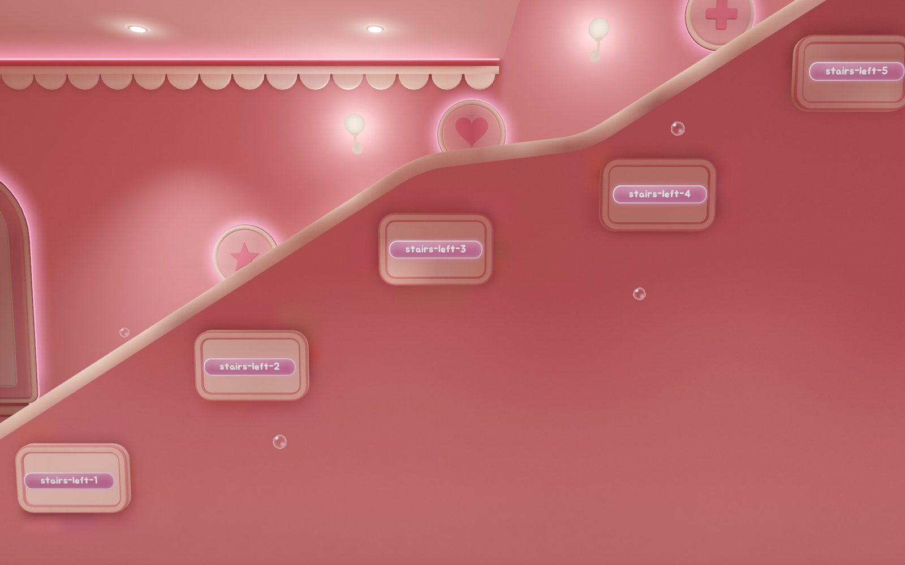
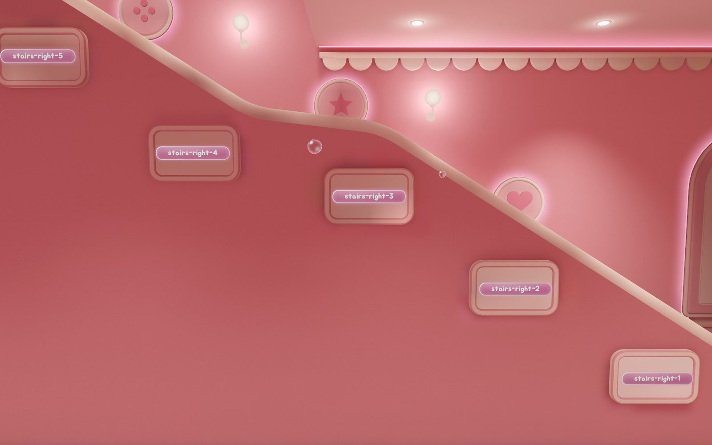

| 칸 이름 | 위치 | 모양 | 알맞은 크기 |
|---|---|---|---|
| `stairs-left-1` | 1층 왼쪽 계단 벽(아래부터) | 가로 16:9 | 768×432 |
| `stairs-left-2` | 1층 왼쪽 계단 벽(아래부터) | 가로 16:9 | 768×432 |
| `stairs-left-3` | 1층 왼쪽 계단 벽(아래부터) | 가로 16:9 | 768×432 |
| `stairs-left-4` | 1층 왼쪽 계단 벽(아래부터) | 가로 16:9 | 768×432 |
| `stairs-left-5` | 1층 왼쪽 계단 벽(아래부터) | 가로 16:9 | 768×432 |
| `stairs-right-1` | 1층 오른쪽 계단 벽(아래부터) | 가로 16:9 | 768×432 |
| `stairs-right-2` | 1층 오른쪽 계단 벽(아래부터) | 가로 16:9 | 768×432 |
| `stairs-right-3` | 1층 오른쪽 계단 벽(아래부터) | 가로 16:9 | 768×432 |
| `stairs-right-4` | 1층 오른쪽 계단 벽(아래부터) | 가로 16:9 | 768×432 |
| `stairs-right-5` | 1층 오른쪽 계단 벽(아래부터) | 가로 16:9 | 768×432 |

### 라운지
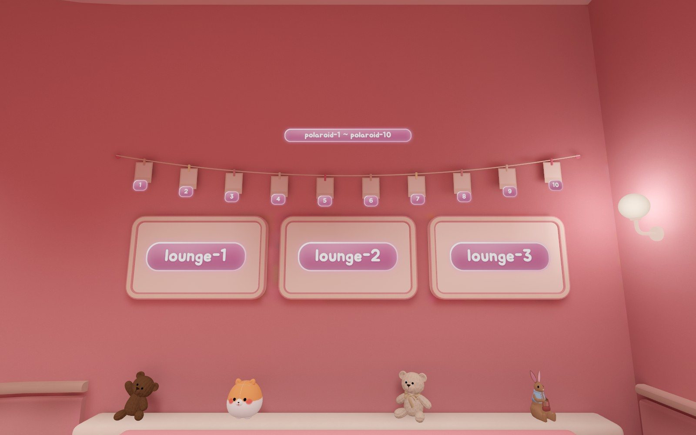

| 칸 이름 | 위치 | 모양 | 알맞은 크기 |
|---|---|---|---|
| `lounge-1` | 라운지 큰 사진 | 가로 16:9 | 1024×576 |
| `lounge-2` | 라운지 큰 사진 | 가로 16:9 | 1024×576 |
| `lounge-3` | 라운지 큰 사진 | 가로 16:9 | 1024×576 |

폴라로이드 10장은 각각 따로 올리면 저장소가 한 장으로 모아 월드에 보냅니다.

| 칸 이름 | 위치 | 모양 | 알맞은 크기 |
|---|---|---|---|
| `polaroid-1` | 라운지 폴라로이드 왼쪽에서 1번째 | 정사각형 | 256×256 |
| `polaroid-2` | 라운지 폴라로이드 왼쪽에서 2번째 | 정사각형 | 256×256 |
| `polaroid-3` | 라운지 폴라로이드 왼쪽에서 3번째 | 정사각형 | 256×256 |
| `polaroid-4` | 라운지 폴라로이드 왼쪽에서 4번째 | 정사각형 | 256×256 |
| `polaroid-5` | 라운지 폴라로이드 왼쪽에서 5번째 | 정사각형 | 256×256 |
| `polaroid-6` | 라운지 폴라로이드 왼쪽에서 6번째 | 정사각형 | 256×256 |
| `polaroid-7` | 라운지 폴라로이드 왼쪽에서 7번째 | 정사각형 | 256×256 |
| `polaroid-8` | 라운지 폴라로이드 왼쪽에서 8번째 | 정사각형 | 256×256 |
| `polaroid-9` | 라운지 폴라로이드 왼쪽에서 9번째 | 정사각형 | 256×256 |
| `polaroid-10` | 라운지 폴라로이드 왼쪽에서 10번째 | 정사각형 | 256×256 |

### 2층 복도 아치
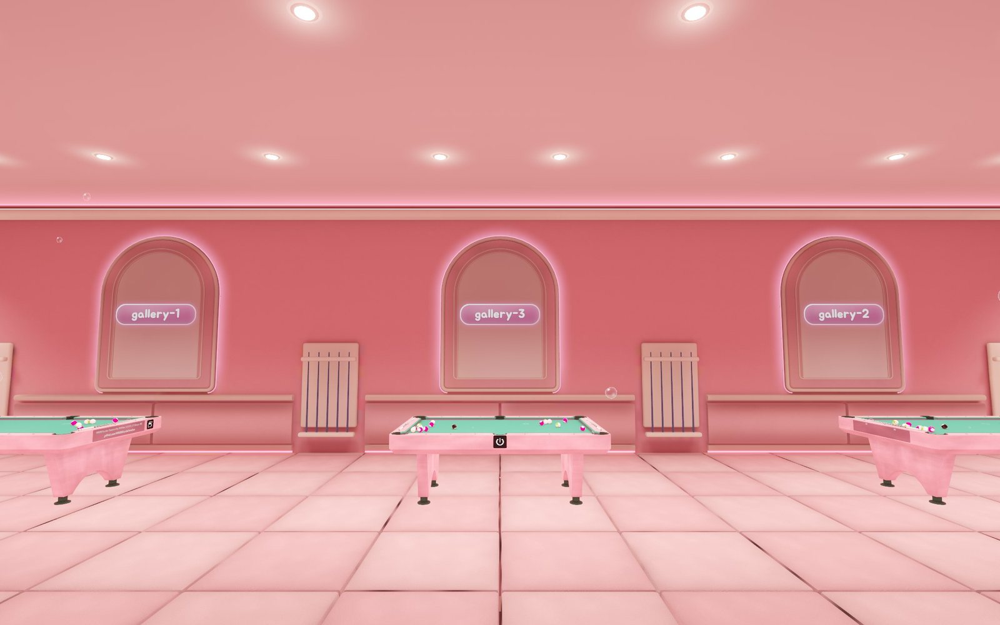
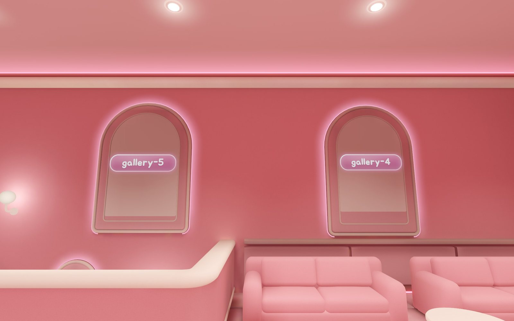
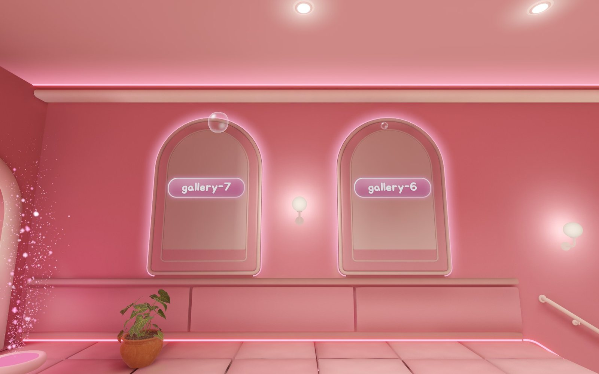
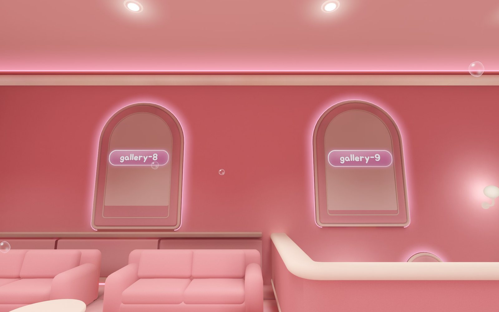
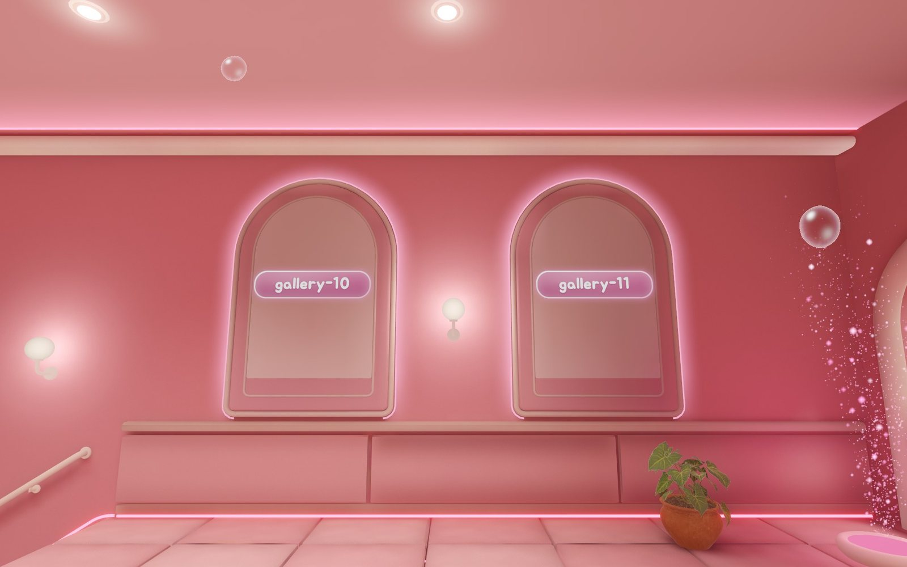

| 칸 이름 | 위치 | 모양 | 알맞은 크기 |
|---|---|---|---|
| `gallery-1` | 2층 입구 쪽 벽 | 세로 2:3 | 683×1024 |
| `gallery-2` | 2층 입구 쪽 벽 | 세로 2:3 | 683×1024 |
| `gallery-3` | 2층 입구 쪽 벽 가운데 | 세로 2:3 | 683×1024 |
| `gallery-4` | 2층 오른쪽 복도 | 세로 2:3 | 683×1024 |
| `gallery-5` | 2층 오른쪽 복도 | 세로 2:3 | 683×1024 |
| `gallery-6` | 2층 오른쪽 복도 | 세로 2:3 | 683×1024 |
| `gallery-7` | 2층 오른쪽 복도 | 세로 2:3 | 683×1024 |
| `gallery-8` | 2층 왼쪽 복도 | 세로 2:3 | 683×1024 |
| `gallery-9` | 2층 왼쪽 복도 | 세로 2:3 | 683×1024 |
| `gallery-10` | 2층 왼쪽 복도 | 세로 2:3 | 683×1024 |
| `gallery-11` | 2층 왼쪽 복도 | 세로 2:3 | 683×1024 |

### 2층 방 (1번~6번 방)
윗줄 왼쪽부터 `room-1`, `room-2`, `room-3`, 아랫줄 왼쪽부터 `room-4`, `room-5`, `room-6`입니다.

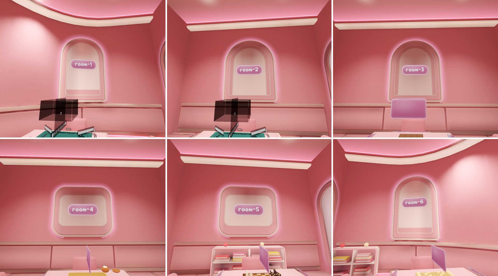

| 칸 이름 | 위치 | 모양 | 알맞은 크기 |
|---|---|---|---|
| `room-1` | 1번 방(마작방 1) 안쪽 벽 | 세로 2:3 | 683×1024 |
| `room-2` | 2번 방(마작방 2) 안쪽 벽 | 세로 2:3 | 683×1024 |
| `room-3` | 3번 방 안쪽 벽 | 세로 2:3 | 683×1024 |
| `room-4` | 4번 방 안쪽 벽 | 가로 3:2 | 1024×683 |
| `room-5` | 5번 방(보드게임방 1) 안쪽 벽 | 가로 3:2 | 1024×683 |
| `room-6` | 6번 방(보드게임방 2) 안쪽 벽 | 세로 2:3 | 683×1024 |

### 스크린 대기 화면
무대 스크린 두 개와 비디오방 스크린, 천장에서 내려오는 스크린에 영상이 없을 때 나오는 그림입니다.

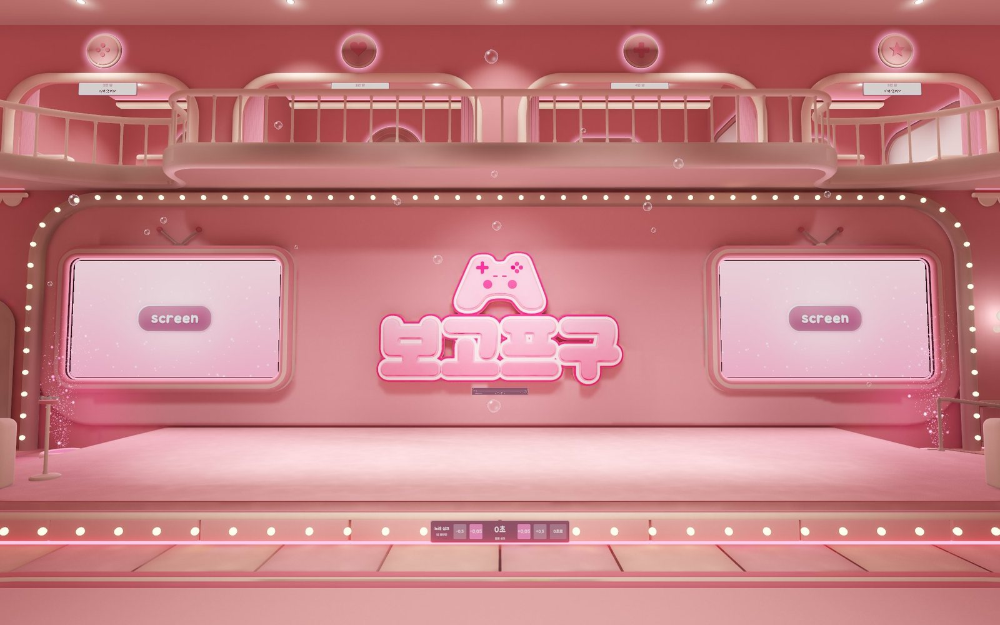

| 칸 이름 | 위치 | 모양 | 알맞은 크기 |
|---|---|---|---|
| `screen` | 무대·비디오방 스크린(영상이 없을 때) | 가로 16:9 | 1280×720 |

## 4. 고칠 사람 추가하기 (저장소 주인만)

1. 저장소 위쪽 **Settings** → 왼쪽 **Collaborators** → **Add people**을 누릅니다.
2. 상대의 GitHub 아이디나 메일을 넣고 초대합니다.
3. 상대가 GitHub 메일이나 알림에서 초대를 **수락**하면 바로 고칠 수 있습니다.

GitHub 계정이 없으면 github.com에서 무료로 만들 수 있습니다.

## 5. 반영이 안 될 때

1. 위쪽 **Actions** 탭을 누릅니다. 맨 위 줄이 방금 고친 내용입니다.
   - 초록 체크: 반영이 끝났습니다. 1~2분 안에 월드에 보입니다.
   - 노란 동그라미: 반영하는 중입니다. 1분쯤 기다립니다.
   - 빨간 X: 실패했습니다. 눌러서 내용을 확인합니다.
2. 초록 체크인데 사진이 안 바뀌면 그 줄을 눌러 **Summary**의 "확인이 필요한 파일"을 봅니다. 칸 이름이 틀리면 여기에 나옵니다.
3. 지금 월드에 나가는 사진과 관리자는 https://missinge.github.io/bogo-data/ 에서 바로 볼 수 있습니다.

## 주의

- 이 저장소는 **공개**입니다. 누구나 볼 수 있으니 개인 정보가 담긴 사진은 올리지 마세요.
- 고친 기록은 모두 남습니다(History). 실수해도 되돌릴 수 있습니다.
- GitHub 웹에서는 파일 하나에 25MB까지 올릴 수 있습니다.
- `tools`, `.github`, `guide` 폴더는 월드 연결에 쓰이니 건드리지 마세요.
